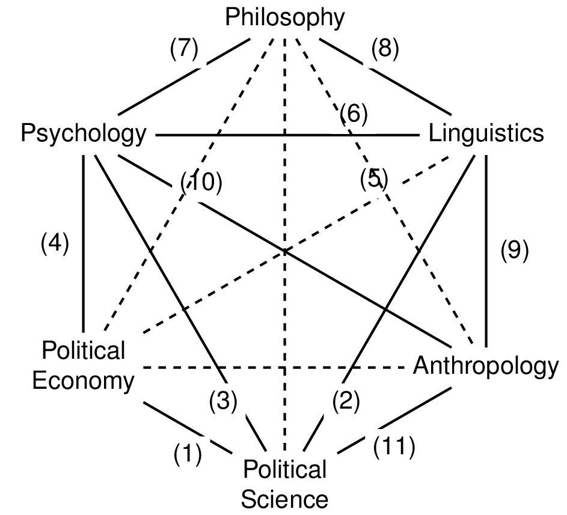

# Description
A visual depiction of the connections between the Cognitive Sciences written in [TikZ](https://en.wikibooks.org/wiki/LaTeX/PGF/TikZ) by [Olivia Guest](https://olivia.science). This figure is derived from the original put forth by the Sloan Foundation in 1978 and reproduced from Figure 4 in Pléh and Gurova, 2013. Different versions of it over time have used ‘Artificial intelligence’ (as above) instead of ‘Computer Science’ and vice versa (cf. Miller, 2003).

As used in: van Rooij, I., Guest, O., Adolfi, F. G., de Haan, R., Kolokolova, A., & Rich, P. (2024). [Reclaiming AI as a theoretical tool for cognitive science.](https://doi.org/10.1007/s42113-024-00217-5) Computational Brain & Behavior.   

# References
Pléh, C., & Gurova, L. (2013). [Existing and would-be accounts of the history of cognitive science: An introduction.](http://plehcsaba.eu/attachments/article/366/Pleh_New_Perspectives_08.compressed.pdf#page=11) Pléh Csaba–Gurova, Lilia–Ropolyi, László (2013 ed.) New Perspectives on the History of Cognitive Science.

Miller, G. A. (2003). [The cognitive revolution: a historical perspective.](https://doi.org/10.1016/S1364-6613(03)00029-9) Trends in cognitive sciences.
